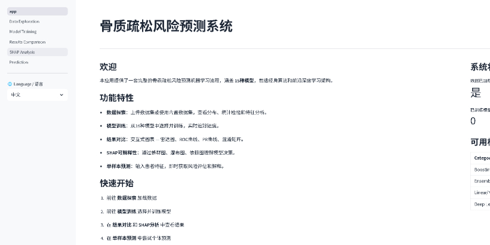

# Osteoporosis Risk Prediction Visualization Platform: Training, SHAP Analysis, Real-Time Prediction One-Stop Solution with a Comprehensive Comparison of 15 Models!

The platform supports real-time prediction of patient information and clearly displays the basis for model decisions. If you have your own osteoporosis clinical data, as long as it is compatible in format, you can directly upload and use it.

Here's a simple demonstration of the program:

\n        \n          \n          \n          \n          \n            To view this video please enable JavaScript, and consider upgrading to a\n            web browser that\n            supports HTML5 video\n  
\n  
Video Player is loading.  
Play VideoPlayMute  
Current Time 0:00  
/  
Duration 2:56  
Loaded: 9.06%  
0:00  
Stream Type LIVE  
Seek to live, currently behind liveLIVERemaining Time -2:56  
1x  
Playback Rate  
Chapters Chapters  
Descriptionsdescriptions off, selected  
Subtitlessubtitles settings, opens subtitles settings dialog  
subtitles off, selected  
Audio Track  
Picture-in-PictureFullscreen
This is a modal window.  
Beginning of dialog window. Escape will cancel and close the window.  
TextColorWhiteBlackRedGreenBlueYellowMagentaCyanTransparencyOpaqueSemi-TransparentBackgroundColorBlackWhiteRedGreenBlueYellowMagentaCyanTransparencyOpaqueSemi-TransparentTransparentWindowColorBlackWhiteRedGreenBlueYellowMagentaCyanTransparencyTransparentSemi-TransparentOpaque  
Font Size50%75%100%125%150%175%200%300%400%Text Edge StyleNoneRaisedDepressedUniformDropshadowFont FamilyProportional Sans-SerifMonospace Sans-SerifProportional SerifMonospace SerifCasualScriptSmall Caps  
Reset restore all settings to the default valuesDone  
Close Modal DialogEnd of dialog window.  

## Images

<!-- PAYMENT_BLOCK -->

## Get this dataset

- Payment link (Stripe): [Buy now](https://buy.stripe.com/3cs8yP7sY87d0vu9AB)
- Payment QR code: 

<!-- /PAYMENT_BLOCK -->
